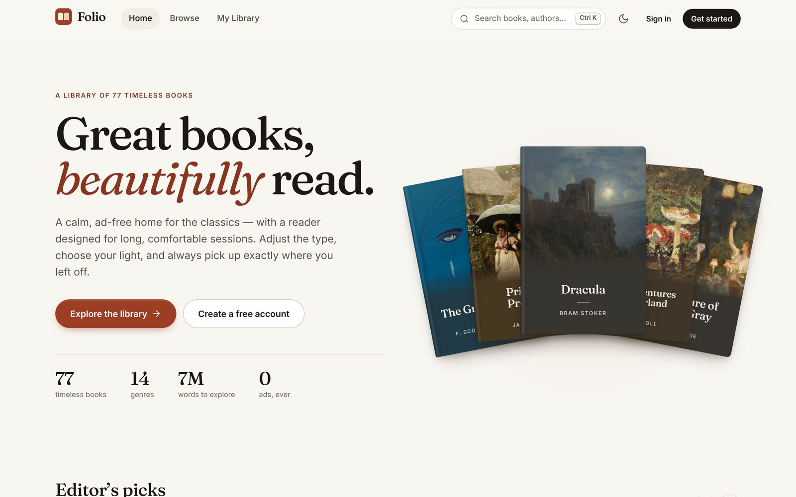
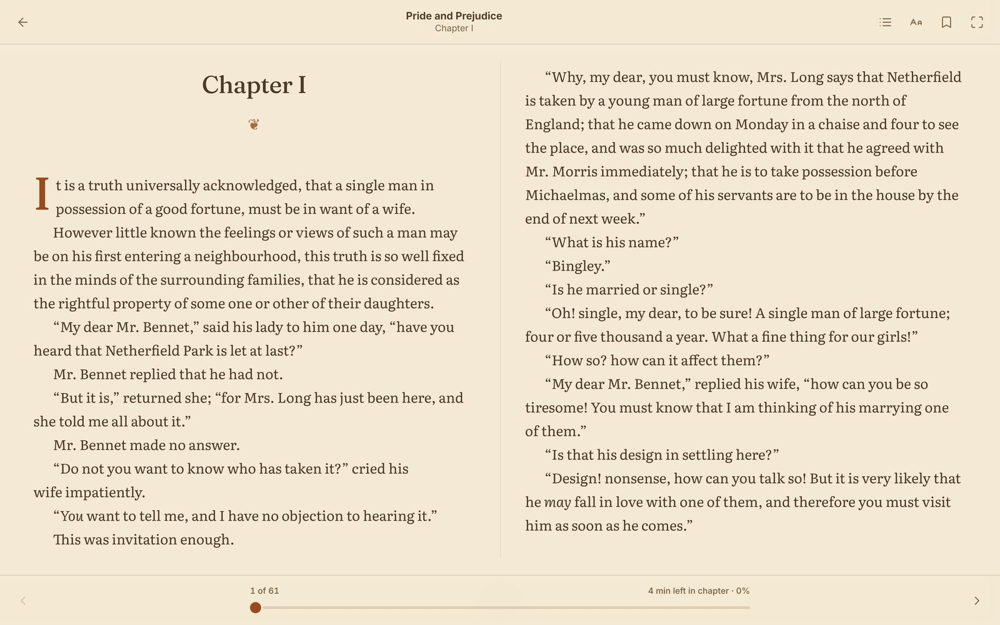
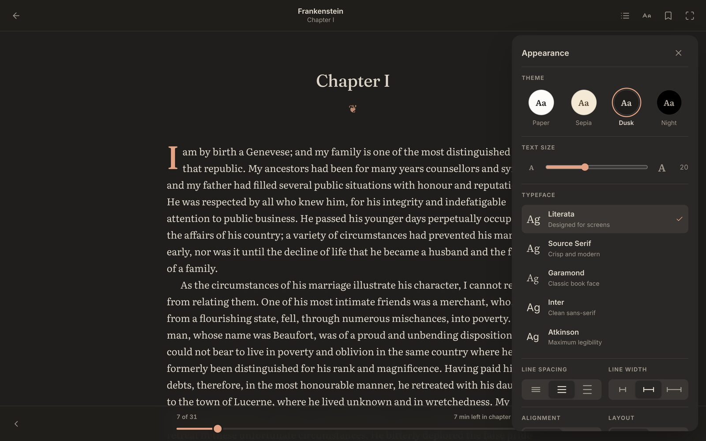
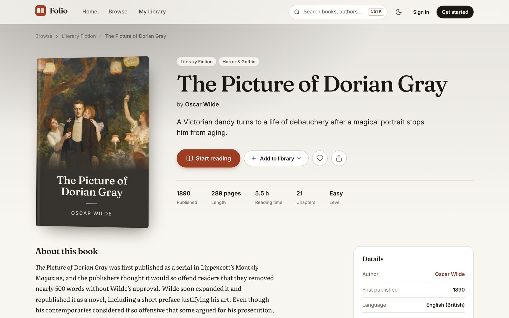
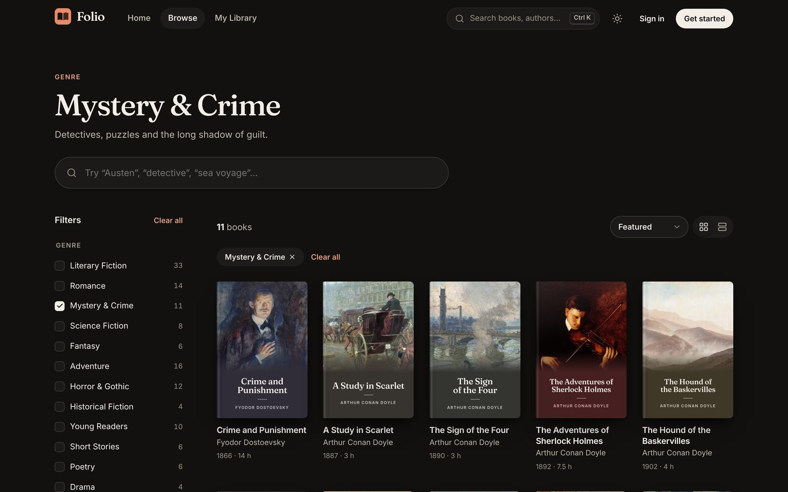

# Folio — great books, beautifully read

Folio is a reading platform for timeless books. It has a calm, ad-free library of **172 public-domain classics** (about 18.6 million words across 15 genres) and a reader built for long, comfortable sessions.



| Reader (paged, Sepia) | Appearance settings (Dusk) |
| --- | --- |
|  |  |

| Book page | Browse with filters (dark mode) |
| --- | --- |
|  |  |

## Features

**Library & discovery**
- 172 complete books, from Homer and Dante to Tolstoy, Austen, Joyce, Christie and Hammett, with covers, descriptions, subjects, award lists, word counts, reading time and reading level.
- Instant search (⌘K / Ctrl K or `/`) across titles, authors, genres, subjects and descriptions. It ignores accents and tolerates typos ("dracla" finds *Dracula*).
- Browse with faceted filters (genre, reading time, era, reading level) that show live counts. Also: author pages, seven sort orders, grid and list views, and URL-synced state you can share or bookmark.
- A curated home page: editor's picks, genre tiles, themed shelves, and *Continue reading* for returning readers.
- Book pages with a 3D cover, table of contents, your progress and bookmarks, "More by this author" and related recommendations.

**Reading experience**
- **Scroll** or **page-turn** layout. On wide screens, page mode shows a two-page spread. It supports swipe, tap zones, arrow keys and Space.
- Four themes (Paper, Sepia, Dusk, true-black Night) and five reading typefaces (Literata, Source Serif, EB Garamond, Inter, Atkinson Hyperlegible).
- Adjustable text size, line spacing and line width, plus left or justified alignment with hyphenation.
- Book typography throughout: drop caps, indented paragraphs, scene-break ornaments, set verse, drama with speaker names, letters and epigraphs, and illustrations that invert in dark themes.
- Progress saves automatically and the reader resumes exactly where you left off. A progress scrubber shows chapter previews, along with time left in the chapter.
- Bookmarks with excerpts and notes, a contents drawer, an end-of-book celebration with "Mark as finished", full screen and keyboard shortcuts (press `?`).

**Your account**
- Registration, sign-in, password change and a full forgot/reset flow.
- My Library shelves: Reading, Want to read, Finished, Favourites and Bookmarks, with undo for removals.
- Reading stats: daily goal ring, streaks, a 14-day chart, time read this week and all-time, and books finished.
- Export all your data as JSON, or clear your reading history.
- Guests can read freely. Their progress carries over when they create an account.

**Quality**
- Fully responsive, with a mobile tab bar and bottom-sheet filters and settings. Light, dark and system themes are applied before first paint, so there's no flash.
- Accessible: semantic landmarks, skip link, labelled controls, keyboard support for every feature, focus-managed dialogs and reduced-motion support. It has **0 axe-core WCAG 2.1 AA violations** across all pages in both themes.
- Fast: about 138 KB (gzip) of initial JavaScript, lazy-loaded routes, chapters loaded on demand with prefetching, responsive WebP covers, and self-hosted variable fonts that load only when used.

## Tech stack

- **Angular 21**: standalone components, signals, zoneless change detection and the new control flow. Every component uses OnPush.
- **Pluggable backend**: a local browser backend by default, or **Supabase** (Auth + Postgres with row-level security) for cross-device sync.
- **Content**: [Standard Ebooks](https://standardebooks.org) EPUBs (CC0), converted at build time into sanitized per-chapter HTML.
- **Testing**: Vitest unit tests through the Angular CLI.

## Getting started

```bash
npm install
npm start          # http://localhost:4200
npm test           # unit tests
npm run build      # production build in dist/folio/browser
```

The app works out of the box with no server. Accounts and reading data live in the browser (see *Backends* below).

## Backends

Choose the backend in `src/environments/environment.ts`:

| `backend` | Accounts | Library, progress, bookmarks | Notes |
| --- | --- | --- | --- |
| `'local'` (default) | Stored in the browser (PBKDF2-SHA-256 password hashes via WebCrypto) | Local storage, synced across tabs | No server needed. Password-reset links are shown on screen because email can't be sent. Needs HTTPS or localhost. |
| `'supabase'` | Supabase Auth (email confirmation and reset emails) | Postgres tables with row-level security, synced in the background (offline-first) | Apply the migrations first. The Supabase client is lazy-loaded, so local mode never downloads it. |

To use Supabase:

1. Apply both SQL files in `supabase/migrations/` to your project, in order. The second one adds the reading tables and fixes a recursive policy in the original `profiles` setup.
2. In Supabase → Authentication → URL configuration, add your site URL and `/reset-password` as a redirect URL.
3. Set `backend: 'supabase'` plus your project URL and anon (publishable) key in `environment.ts`.

All user data is written locally first, so reading works offline. Changes are pushed in the background and retried when the connection returns. On sign-in, local and remote data are merged, with the newest change winning.

## Content pipeline

The library is generated by `scripts/import-books.mjs` from the list in `scripts/books.config.mjs`:

```bash
npm run import-books                        # rebuild everything (downloads are cached in .cache/)
node scripts/import-books.mjs --only=emma   # re-import selected books
```

For each book the script:

1. Downloads the Standard Ebooks EPUB.
2. Parses its metadata and table of contents.
3. Splits it into chapters (plays by scene, poetry collections by poem, very long chapters at scene breaks).
4. Sanitizes the XHTML into a small whitelist of reader-friendly HTML.
5. Optimises illustrations (with width and height set to prevent layout shift).
6. Crops the cover artwork into responsive WebP files and samples a palette colour for the typographic cover.

The output (`public/books`, `public/covers`, `src/app/data/catalog.data.ts`) is committed, so building the app needs no network. Re-running the importer requires ImageMagick.

To add a book, append its Standard Ebooks path, year of publication and genres to `books.config.mjs`, then run the importer.

## Project structure

```
src/app/
  app.component.ts / app.config.ts / app.routes.ts   shell, providers, lazy routes
  config.ts, guards.ts
  data/catalog.data.ts          generated catalog metadata
  layout/                       header, mobile nav, footer, search palette, toasts
  models/                       book and user types
  pages/
    home/  browse/  book/       discovery
    reader/                     reader + appearance and contents panels
    library/  account/          personal library and stats
    auth/                       sign-in, sign-up, forgot and reset password
  services/
    auth/                       AuthService facade + local and Supabase backends
    sync/                       Supabase sync adapter
    catalog.service.ts          search, filters, recommendations
    book-content.service.ts     table-of-contents and chapter loading with caching
    library.service.ts          shelves, progress, bookmarks, stats (local-first)
    reader-settings.service.ts  typography and theme preferences
  shared/                       book cover, card, shelf, icons, shelf menu
  utils/                        formatting, text, storage, passwords
scripts/                        content import pipeline
supabase/migrations/            database schema and RLS policies
```

## Deployment

`npm run build` produces a static site in `dist/folio/browser`. Serve it from any static host with an SPA fallback, so that unknown routes are rewritten to `index.html` (for example Netlify `_redirects`, Vercel rewrites, or nginx `try_files $uri /index.html`). Enable gzip or Brotli. Chapter files are plain HTML fragments and compress very well.

## Credits

Book texts and cover artwork come from [Standard Ebooks](https://standardebooks.org). They are believed to be in the US public domain, and Standard Ebooks dedicates its contributions to the public domain under [CC0 1.0](https://creativecommons.org/publicdomain/zero/1.0/). Folio's cover designs set this public-domain artwork with original typography. Folio is not affiliated with Standard Ebooks.

Fonts: Fraunces, Inter, Literata, Source Serif 4, EB Garamond and Atkinson Hyperlegible Next (SIL Open Font License), self-hosted via Fontsource.
